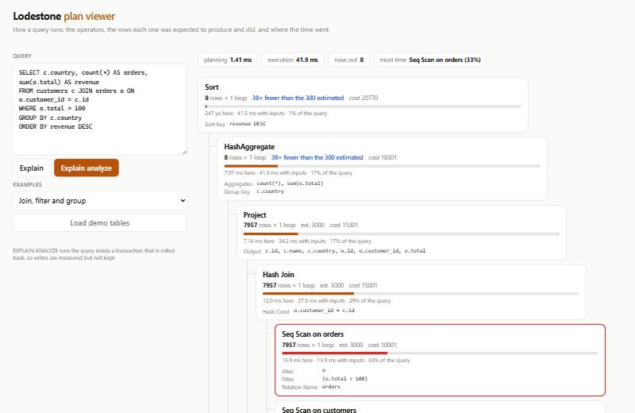

# Lodestone

A SQL database written from scratch: pages, a write-ahead log with crash recovery, a B+tree, MVCC transactions, a SQL parser, an optimiser and an executor, all in Rust. A Go server speaks the PostgreSQL protocol in front of it, so `psql` and PostgreSQL drivers can connect. A TypeScript page shows how queries run.

- **Engine** (Rust, ~9,400 lines; dependencies: CRC32, JSON, MD5, a random number generator).
- **PostgreSQL server** (Go). It handles the simple and extended protocols, text and binary formats, SQLSTATE codes and the transaction status. Clients tested: `pgx` and `psql`.
- **Plan viewer** (TypeScript). For each operator it shows the rows estimated vs. produced, the time spent there, and where the estimate was more than 10× off.



## Results

### Correctness: sqllogictest

The evaluation runs a fixed sample of SQLite's [sqllogictest](https://www.sqlite.org/sqllogictest) corpus (public domain): 45 files, 289,373 records ([`scripts/fetch-slt.sh`](scripts/fetch-slt.sh) lists them). Each file runs on a fresh database.

| | records | passed |
|---|---|---|
| `select1`–`select5` | 10,706 | **10,706 (100%)** |
| `random/` (aggregates, expr, groupby, select; 5 files each) | 200,238 | 199,769 (99.77%) |
| `index/` (between, commute, delete, in, orderby, orderby_nosort, random, view; 10-row variants) | 78,105 | **78,105 (100%)** |
| `evidence/` | 324 | 291 |
| **all** | **289,373** | **288,871 (99.83%)** |

All 502 failures are accounted for ([`results/sqllogictest.json`](results/sqllogictest.json)):

| failures | why |
|---|---|
| 457 | A bare column outside GROUP BY (`SELECT col1 ... GROUP BY col0`). SQLite accepts it and picks any row's value; PostgreSQL rejects it, and Lodestone follows PostgreSQL. |
| 23 | Triggers: not supported. |
| 12 | Division by zero: SQLite returns NULL, PostgreSQL (and Lodestone) raise an error. |
| 8 | `INSERT OR REPLACE` / `REPLACE INTO`: not supported, plus the queries that read its rows. |
| 2 | Blob literals `x'...'`: there is no BLOB type. |

No query in the sample returns a wrong answer where Lodestone claims to support the feature. 58,732 records are reserved for other engines (`onlyif mysql`, ...) and are skipped.

The runner itself is checked: a deliberately wrong expected result is reported as a failure, and hashed results are compared by MD5, as the reference runner does.

### Durability: killing the process mid-write

`lodestone crash-check <db> 300` ([`crash.rs`](engine/src/crash.rs)) works like this:
1. It starts a worker process in which **two sessions** write transactions concurrently. Each transaction inserts 1–20 rows that all record their transaction's size, rewrites an old row, and bumps a counter.
2. A transaction is reported on stdout only after its COMMIT returns.
3. The harness kills the worker at a random moment (TerminateProcess on Windows, SIGKILL elsewhere), reopens the database, checks it, and starts the next run on the same file.
4. A 512 KB checkpoint threshold makes kills also land during checkpoints.

After each kill, the database must have:
- every reported transaction present, and each present transaction whole;
- at most one unreported transaction per writer (one that committed just before the kill);
- counters equal to the number of transactions;
- no transaction still marked active;
- a B+tree that passes the invariant check (key order, bounds, depth, leaf chain, page fit).

| | |
|---|---|
| kills | 300 |
| failed checks | **0** |
| transactions committed | 7,705 (146 committed but not yet reported when the process died) |
| kills with a checkpoint since the previous kill | 96 |

**The test catches real bugs.** With recovery's rollback of unfinished transactions switched off, 19 of 20 kills failed the check. With two writers, one's commit flushes pages that hold the other's uncommitted versions, so recovery has real work to do.

**A kill is not a power cut.** A killed process loses no data the OS already holds, so this test cannot catch a missing `fsync`. Power cuts are covered separately on a simulated disk ([`vfs.rs`](engine/src/storage/vfs.rs), [`storage/mod.rs`](engine/src/storage/mod.rs)), 300 seeds:
1. After a random number of writes and syncs, every I/O fails.
2. The disk then keeps only what was synced, plus a random part of the rest, some of it torn at 512-byte sectors.
3. After reopening, the store must equal either the last commit that returned or the one in progress, and its tree must be whole.

That test also catches real bugs: checkpointing in the wrong order (emptying the log before syncing the database file) fails it at once.

### Speed: against SQLite 3.54

[`bench.rs`](engine/src/bin/bench.rs) runs both engines in one process, on the same disk and data: 100,000 rows in `t(id, k, v)` and 100,000 in `u`, Windows 11 on an NVMe SSD. Both are durable at commit: SQLite in WAL mode with `synchronous=FULL`, Lodestone syncing its log at every commit. Every query's answer is checked to be equal ([`results/bench.json`](results/bench.json)).

| workload | Lodestone | SQLite | SQLite faster by |
|---|---|---|---|
| insert, one transaction | 36,356 rows/s | 367,341 rows/s | 10.1× |
| insert, a durable commit each | 388 rows/s | 453 rows/s | 1.2× |
| point lookup by primary key | 35,795 /s | 88,266 /s | 2.5× |
| count by secondary index | 10,021 /s | 79,660 /s | 7.9× |
| range of 101 rows by primary key | 6,596 /s | 39,554 /s | 6.0× |
| full scan + GROUP BY (100k rows) | 9 /s | 22 /s | 2.4× |
| join of two 100k-row tables | 6 /s | 9 /s | 1.6× |
| update by primary key, one transaction | 9,544 rows/s | 30,038 rows/s | 3.1× |
| size on disk | 73.4 MB | 22.6 MB | |

**SQLite is faster everywhere.** The gap is narrowest where the disk dominates (durable commits) or the work is per row (joins, full scans). It is widest for small statements:
- SQLite runs prepared statements, while Lodestone parses and plans every statement again (there is no plan cache);
- every MVCC write also stores a rollback record.

The data takes about 3× the space: rows are stored once per version, keys are escaped, nodes are encoded simply, and empty pages are never reused.

**A bug the benchmark exposed.** The first run had primary-key lookups 26× slower than SQLite. The bulk load had emptied thousands of B+tree leaves (rollback records are deleted at commit), and every range scan walked through them along the leaf chain. Emptied leaves are now unlinked from the tree, and lookups got 11× faster.

## How it works

```
            psql / pgx ──► lodestone-pg (Go) ─────────────────┐
                           PostgreSQL protocol v3              │ JSON lines over TCP
   plan viewer (TS) ──► HTTP /api/explain, /api/query          ▼
                                                    lodestone serve (Rust)
                                         SQL: parser → binder → optimiser → executor
                                         MVCC: versions, snapshots, conflicts
                                         B+tree ── pager (cache, no-steal) ── WAL ── file
```

**Storage** ([`storage/`](engine/src/storage)):
- 4 KB pages hold B+tree nodes, decoded in a page cache.
- **Pages are no-steal**: a changed page stays in memory until commit, so recovery never has to undo a page.
- A **commit** appends the full copy of every changed page to the write-ahead log and syncs it. Each frame's CRC-32 chains on the previous frame's, so a torn or stale frame ends the replay.
- A **checkpoint** copies the newest pages into the database file, syncs it, and only then starts a new log.
- **The B+tree** keeps its root on page 1, splits by bytes, chains its leaves, and unlinks leaves that become empty. Underfull leaves are not merged, and freed pages are not reused.
- A key plus its value must fit in 1,000 bytes. Table and view definitions are split into chunks, but **a row is limited to about 950 bytes**.

**MVCC** ([`mvcc.rs`](engine/src/mvcc.rs)) gives snapshot isolation:
- **Versions**: every write is a new version of its key, tagged with the transaction's number. A transaction sees what had committed when it began.
- **Conflicts**: writing a key that has a version the writer cannot see is a write-write conflict, reported as SQLSTATE 40001.
- **Commit, rollback, recovery**: commit removes the transaction's active marker; rollback also deletes its versions. Since commits flush other transactions' uncommitted versions, recovery rolls back every transaction still marked active.
- **VACUUM** drops versions that no live snapshot can see.
- **Catalog**: tables, indexes and views are versioned keys too, so DDL is transactional (`BEGIN; CREATE TABLE ...; ROLLBACK` leaves nothing behind).

**SQL** ([`sql/`](engine/src/sql)):
- **Parsing**: a recursive-descent parser with PostgreSQL's operator precedence.
- **Binding**: names become column positions, aggregates are extracted, and correlated subqueries are detected and remapped when a query is aggregated.
- **The optimiser**:
  - folds constants and pushes predicates down to the tables they read;
  - picks primary-key lookups and ranges or index lookups and ranges, depending on the static type of the comparison value;
  - orders inner joins greedily (smallest input first, then whatever joins by equality), using hash joins built on the smaller side;
  - plans outer joins as units.
- **Estimates** come from per-table row counters and fixed selectivities. The plan viewer shows where they fail (the 38× error in the screenshot is a GROUP BY estimate).
- **The executor** pulls rows through iterators and scans storage in batches. Uncorrelated subqueries run once and are cached; correlated ones run once per row.
- **Supported SQL**:
  - SELECT with joins (inner, left, right, cross, USING), GROUP BY / HAVING, ORDER BY with NULLS FIRST/LAST, LIMIT/OFFSET, DISTINCT, UNION/INTERSECT/EXCEPT [ALL], and subqueries (scalar, IN, EXISTS, correlated);
  - INSERT ... VALUES / SELECT, UPDATE, DELETE;
  - CREATE/DROP TABLE, INDEX (unique too) and VIEW;
  - transactions, EXPLAIN [ANALYZE] [FORMAT JSON], VACUUM, CHECKPOINT;
  - `$n` parameters, whose types Describe infers from context, as PostgreSQL does.
- **Types**: INTEGER (64-bit), FLOAT, TEXT and BOOLEAN. NUMERIC is stored as FLOAT, and there is no date type.

## Running it

```bash
cd engine && cargo build --release && cd ..
cd server && go build -o ../bin/lodestone-pg ./cmd/lodestone-pg && cd ..
cd web && npm ci && npm run build && cd ..

bin/lodestone-pg --engine-bin engine/target/release/lodestone --db data/demo.db --web web/dist
psql -h 127.0.0.1 -p 5433 -U me lodestone       # any user name; there is no authentication
# plan viewer: http://127.0.0.1:8088 ("Load demo tables", then pick an example)
```

Without the server: `engine/target/release/lodestone shell data/demo.db`.

The evaluations:

```bash
scripts/fetch-slt.sh                                                    # 45 files, 49 MB
engine/target/release/lodestone slt --json data/slt-all.json $(find data/slt -name '*.test' | sort)
python scripts/slt_summary.py data/slt-all.json                         # results/sqllogictest.json
engine/target/release/lodestone crash-check data/crash.db 300 --json results/crash-test.json
cd engine && cargo run --release --features bench --bin lodestone-bench -- --json ../results/bench.json
```

Tests:
- `cargo test` (storage, MVCC, SQL, the power-cut simulation, a short crash test);
- `go test ./...` (set `LODESTONE_BIN` to run the pgx tests against the real engine);
- `npm test` (the viewer).

CI also runs `select1`–`5` and a `psql` session.

## Limits

- **Size and types**: rows of about 950 bytes at most, no BLOB or date types, and no FOREIGN KEY, CHECK, triggers, window functions, CTEs or `INSERT OR REPLACE`.
- **One writer at a time**: a single lock guards the storage. Sessions interleave rather than write in parallel, and there is no group commit.
- **Statistics are rough**: row counters are not transactional, and selectivities are fixed guesses.
- **The protocol server**:
  - no authentication or TLS (bind it to localhost);
  - no COPY or cancel requests;
  - none of the system catalogs, so `psql`'s `\d` commands do not work;
  - results are sent whole, not in batches.
- **Space is never given back**: emptied pages are not reused, so the file does not shrink.
